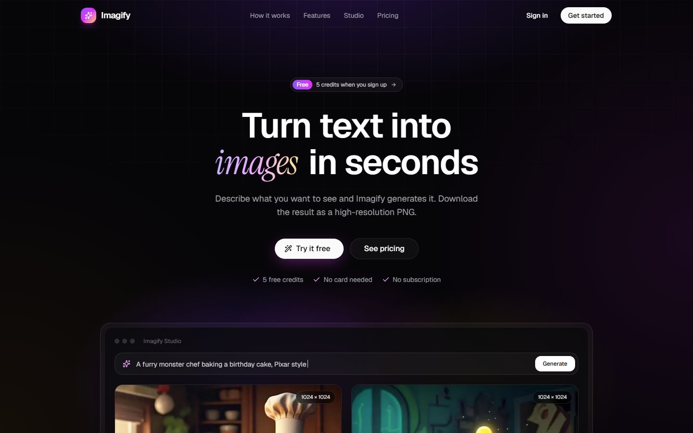
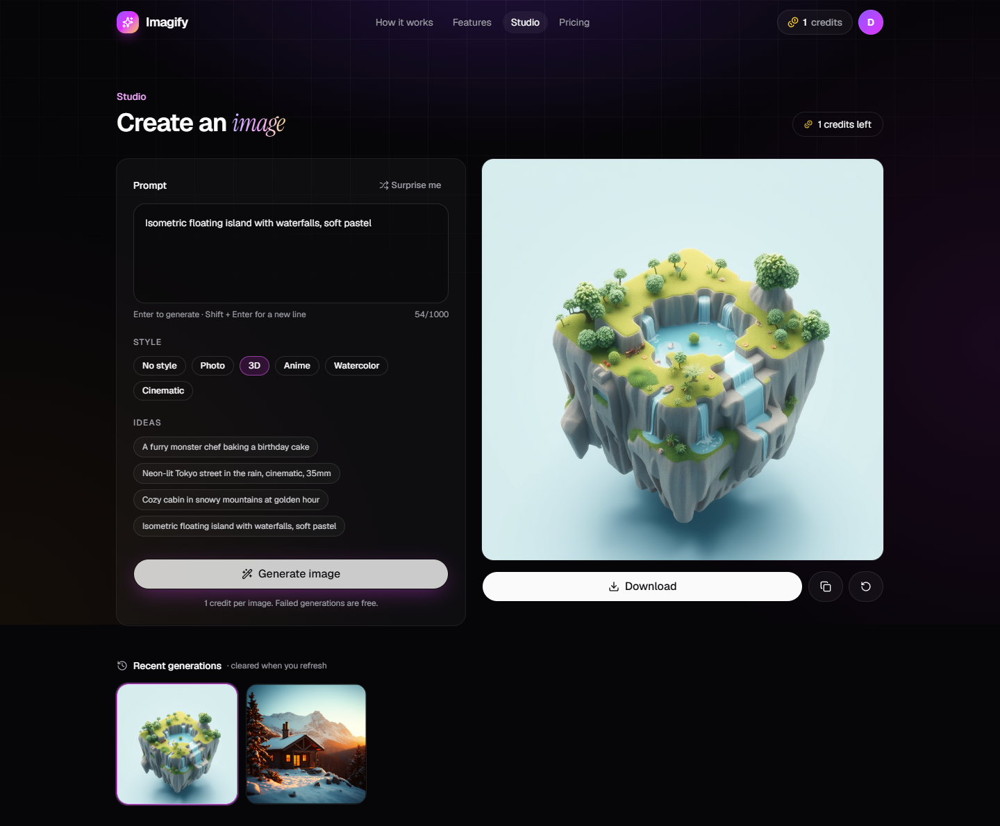
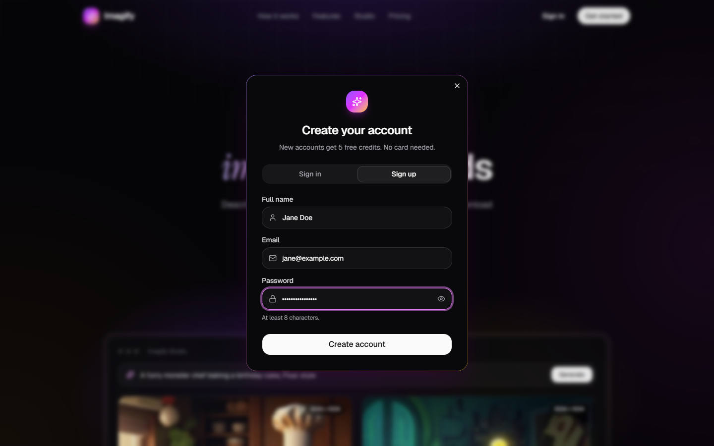
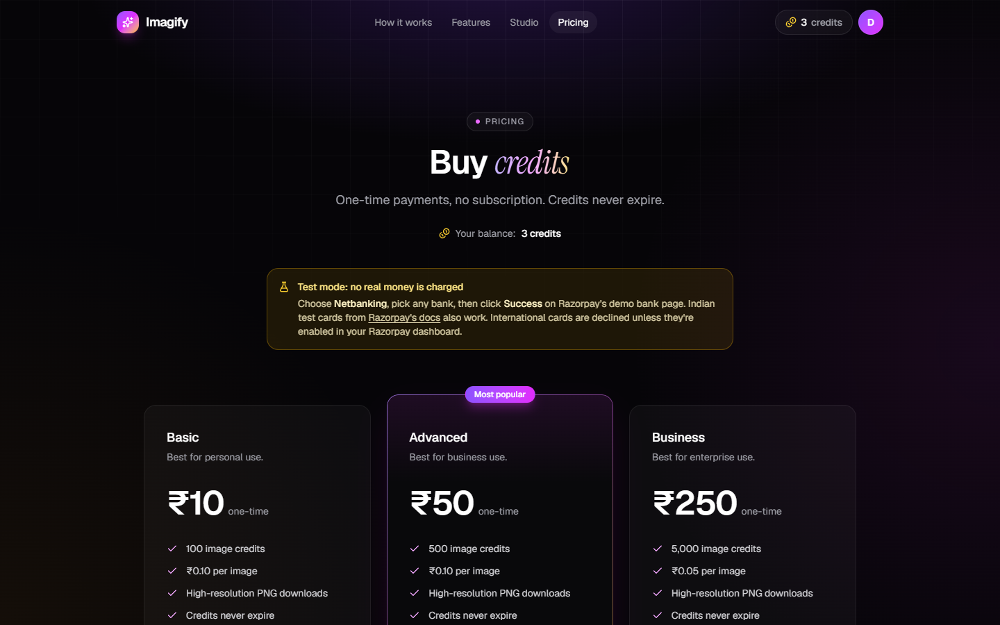
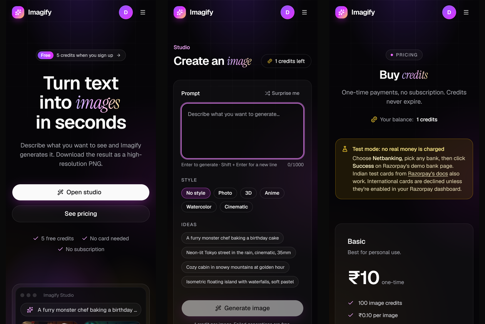
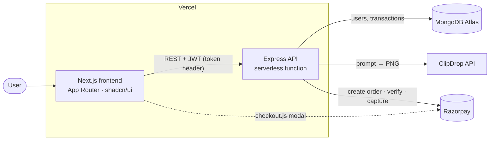
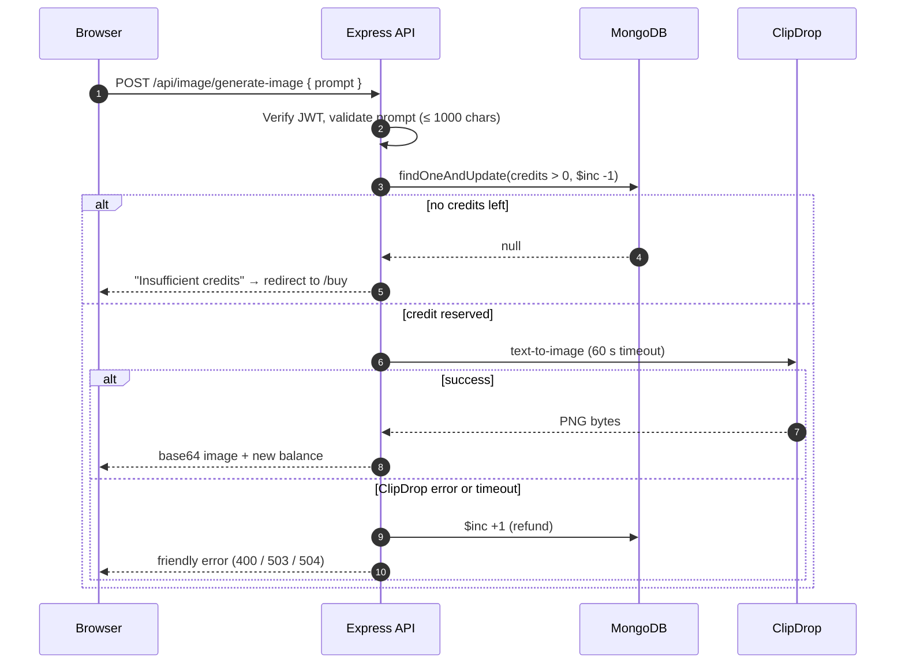
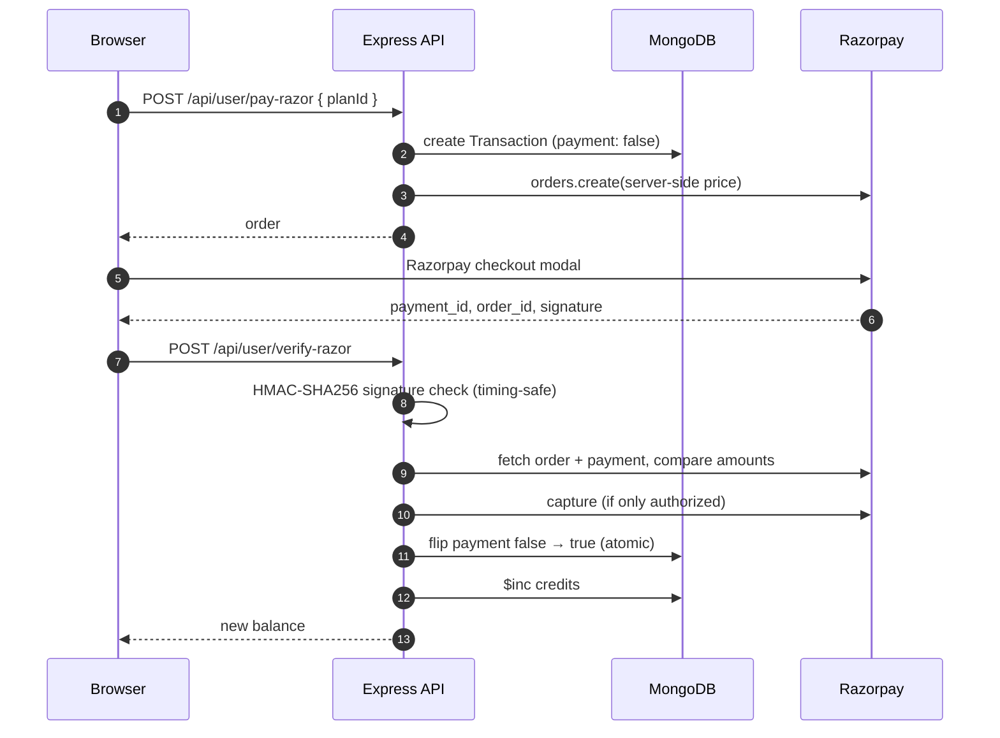
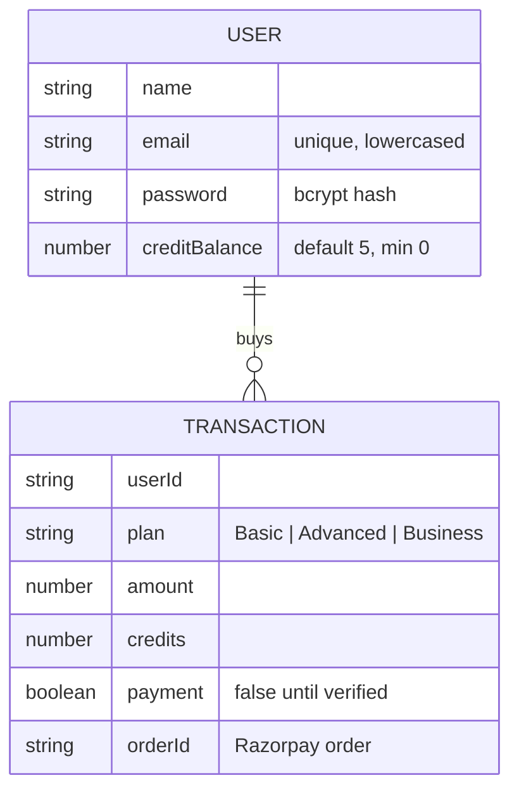

<div align="center">

# Imagify

**Text-to-image SaaS with pay-as-you-go credits.**
Type a prompt, get a 1024×1024 image in seconds, and buy more credits when you run out.

[](https://imagify-nu-six.vercel.app)


[Demo](#demo) · [Architecture](#architecture) · [Engineering highlights](#engineering-highlights) · [API](#api) · [Run locally](#run-locally)


</div>

## At a glance

| | |
| :--- | :--- |
| **What it is** | A full-stack SaaS: landing page, auth, an image studio, a credit wallet and real payments |
| **User flow** | Sign up → get 5 free credits → generate images (1 credit each) → buy a credit pack when you run out |
| **Frontend** | Next.js 16 App Router, React 19, Tailwind CSS v4, shadcn/ui, Motion |
| **Backend** | Node.js + Express 5 REST API, MongoDB (Mongoose), JWT auth, bcrypt |
| **Integrations** | ClipDrop text-to-image API, Razorpay checkout (orders, signature verification, capture) |
| **Hosting** | Two Vercel projects: Next.js frontend and the Express API as a serverless function |

## Demo

| Landing page | Studio |
| :---: | :---: |
|  |  |
| **Sign up (5 free credits)** | **Credit packs** |
|  |  |

<details>
<summary><b>Mobile</b> (fully responsive)</summary>
<br>

</details>

**Studio features:** style presets (Photo, 3D, Anime, Watercolor, Cinematic), one-click prompt ideas and a "Surprise me" button, a live progress state, one-click PNG download, copy prompt, and the last 12 generations of the session.

| Plan | Credits | Price (INR) | Per image |
| :--- | ---: | ---: | ---: |
| Free (on sign-up) | 5 | 0 | – |
| Basic | 100 | ₹10 | ₹0.10 |
| Advanced | 500 | ₹50 | ₹0.10 |
| Business | 5,000 | ₹250 | ₹0.05 |

## Architecture



The browser never talks to ClipDrop and never decides how many credits it has: **the API owns credits, prices and payment verification.** The frontend only renders what the API returns.

### Generating an image

Credits are reserved *before* the paid ClipDrop call and refunded if it fails, so users are never charged for a failed image and parallel requests can't overspend.



### Buying credits

The client never says how much it paid. The server picks the price, then checks Razorpay's signature *and* re-reads the order and payment from Razorpay before adding credits, exactly once.



### Data model



## Engineering highlights

**Money and credits**
- **No double spending.** Credits are deducted with one atomic, conditional `findOneAndUpdate`, so ten parallel requests with one credit produce one image, not ten.
- **Failed generations are free.** The reserved credit is refunded on any ClipDrop error or timeout.
- **Server-side pricing.** Plans live in `server/controllers/user.controller.js`; the client only sends a plan id (checked with `Object.hasOwn`, so `__proto__` style keys can't slip through). The list in `client/src/assets/assets.js` is display-only and must be kept in sync.
- **Payment verification in depth.** Timing-safe HMAC signature check, then the order and payment are fetched from Razorpay and the amounts compared. Authorized-but-uncaptured payments are captured so customers are never charged without receiving credits.
- **Idempotent crediting.** A transaction flips from unpaid to paid atomically, so retries or duplicate callbacks add credits only once.

**Security**
- bcrypt-hashed passwords, JWTs with expiry, and clean handling of expired sessions on the client.
- NoSQL injection guard: login inputs must be strings, so payloads like `{ "$ne": null }` are rejected.
- Same error for unknown email and wrong password, so accounts can't be probed.
- 10 KB JSON body limit, CORS allowlist via `CLIENT_URL`, and no stack traces or internal errors sent to clients.

**Frontend**
- Generated images are converted from base64 to Blob URLs (about half the memory, instant downloads) and revoked when they leave history.
- Hydration-safe auth state, so the server render and first client render always match.
- The build fails fast if `NEXT_PUBLIC_BACKEND_URL` is missing or points to localhost on Vercel, instead of shipping a site that can't reach its API.

## API

| Method | Endpoint | Body | Purpose | Auth |
| :--- | :--- | :--- | :--- | :---: |
| `POST` | `/api/user/register` | `name`, `email`, `password` | Create an account (password ≥ 8 chars, gets 5 credits) | |
| `POST` | `/api/user/login` | `email`, `password` | Log in, returns a JWT | |
| `GET` | `/api/user/credits` | | Current credit balance | ✅ |
| `POST` | `/api/image/generate-image` | `prompt` | Generate an image from a prompt | ✅ |
| `POST` | `/api/user/pay-razor` | `planId` (`Basic`, `Advanced`, `Business`) | Create a Razorpay order for a plan | ✅ |
| `POST` | `/api/user/verify-razor` | `razorpay_order_id`, `razorpay_payment_id`, `razorpay_signature` | Verify the payment and add credits | ✅ |

Authenticated routes expect the JWT in a `token` header. All responses are JSON shaped as `{ success, message, ... }`, and request bodies are limited to 10 KB.

## Project structure

```text
Imagify/
├── client/                  Next.js frontend
│   └── src/
│       ├── app/             Routes: / (home), /result (studio), /buy (pricing), error + 404
│       ├── components/      Navbar, auth dialog, studio, pricing, landing sections, ui/ (shadcn)
│       ├── context/         AppContext: session, credits, generation history
│       └── lib/             API helpers, Razorpay loader, formatting
└── server/                  Express API
    ├── controllers/         User/payment and image logic
    ├── middlewares/         JWT auth
    ├── models/              User, Transaction
    ├── routes/              /api/user, /api/image
    └── server.js            App setup, CORS, error handling
```

## Run locally

**Prerequisites:** Node.js 20.9+, a MongoDB database (Atlas free tier works), a [ClipDrop API key](https://clipdrop.co/apis), and [Razorpay test keys](https://dashboard.razorpay.com/app/keys).

```bash
git clone https://github.com/Navraj86/Imagify.git
cd Imagify

# API → http://localhost:4000
cd server && npm install && cp .env.example .env   # fill in .env
npm run dev

# Frontend → http://localhost:3000 (second terminal)
cd client && npm install && cp .env.example .env   # fill in .env
npm run dev
```

<details>
<summary><b>Environment variables</b></summary>

**`server/.env`**

| Variable | Description |
| :--- | :--- |
| `PORT` | API port, default `4000` |
| `MONGODB_URI` | MongoDB connection string (the `imagify` database is selected automatically) |
| `JWT_SECRET` | Any long random string |
| `JWT_EXPIRES_IN` | Session length, e.g. `7d` |
| `CLIPDROP_API` | ClipDrop API key |
| `RAZORPAY_KEY_ID` / `RAZORPAY_KEY_SECRET` | Razorpay keys (use `rzp_test_` keys locally) |
| `CURRENCY` | Currency Razorpay charges in, e.g. `INR` |
| `CLIENT_URL` | Optional. Comma-separated frontend URLs allowed by CORS |

**`client/.env`**

| Variable | Description |
| :--- | :--- |
| `NEXT_PUBLIC_BACKEND_URL` | API URL, e.g. `http://localhost:4000` |
| `NEXT_PUBLIC_RAZORPAY_KEY_ID` | Same key id as the server |
| `NEXT_PUBLIC_CURRENCY` | Must match `CURRENCY` on the server |

</details>

<details>
<summary><b>Testing payments</b></summary>

With `rzp_test_` keys no real money moves, and the pricing page shows a test-mode notice.

1. Open **Pricing** and pick a plan.
2. In the Razorpay window choose **Netbanking** and any bank.
3. On the demo bank page click **Success** (or **Failure** to see a declined payment).

Razorpay's [Indian test cards](https://razorpay.com/docs/payments/payments/test-card-details/) also work.
</details>

<details>
<summary><b>Deploying to Vercel</b></summary>

Create two Vercel projects from this repo:

- **API:** root directory `server` (a `vercel.json` is included). Add the server variables and set `CLIENT_URL` to the frontend URL.
- **Frontend:** root directory `client`. Add the three `NEXT_PUBLIC_` variables, with `NEXT_PUBLIC_BACKEND_URL` set to the deployed API.

`NEXT_PUBLIC_` values are baked in at build time, so redeploy the frontend after changing them.
</details>

## Roadmap

- Razorpay webhook as a backup to the browser callback, so credits still land if the tab closes mid-payment
- Store images in object storage (S3 / R2) and keep a per-user gallery instead of session-only history
- Rate limiting on auth and generation endpoints
- Automated tests for the credit and payment flows

## License

MIT
